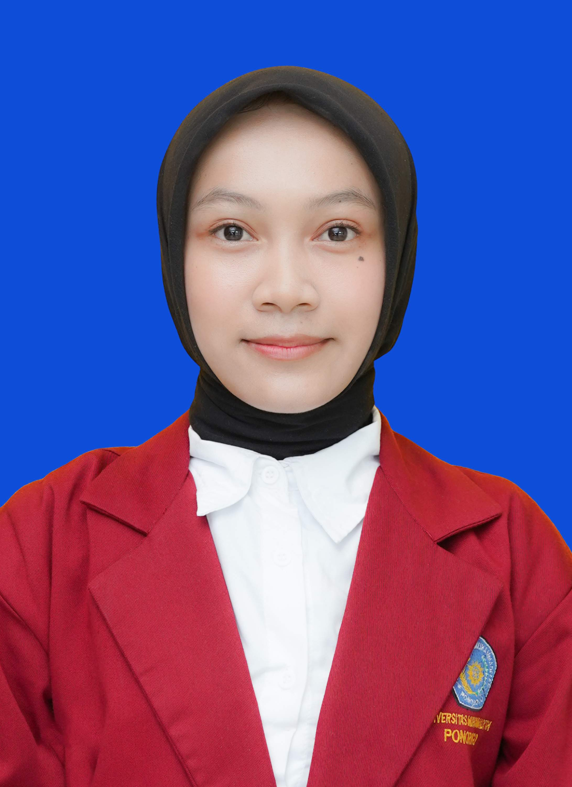

# Cindy Alya Putri Portfolio

<p align="center">
  
</p>

<h3 align="center">
  Machine Learning Engineer | AI Engineer | Data Analyst
</h3>

<p align="center">
  A personal portfolio showcasing my projects, technical skills, and professional journey in Artificial Intelligence, Machine Learning, and Software Development.
</p>

<p align="center">
  <a href="YOUR_PORTFOLIO_URL">Live Portfolio</a> •
  <a href="YOUR_LINKEDIN_URL">LinkedIn</a> •
  <a href="YOUR_GITHUB_URL">GitHub</a>
</p>

---

## About Me

Hi! I'm **Cindy Alya Putri**, an undergraduate student passionate about Artificial Intelligence, Machine Learning, and backend engineering.

I enjoy building intelligent applications, developing machine learning models, exploring data-driven solutions, and transforming ideas into practical software systems.

My interests include:
- Artificial Intelligence & Machine Learning
- Deep Learning & Neural Networks
- Data Analysis & Data Processing
- Backend Development & RESTful APIs
- Model Deployment & AI Integration

---

## Portfolio Highlights

This portfolio showcases selected projects across different areas of technology.

| Project | Category | Description |
|---|---|---|
| Clove Leaf Nutrient Deficiency Detection | AI / Computer Vision | Graph-based classification of clove leaf nutrient deficiencies using GCN. |
| CarPathMu | Machine Learning | Career recommendation system powered by a deep learning model. |
| Book Recommendation System | Recommendation Systems | Personalized book recommendations using Content-Based and Collaborative Filtering. |
| Gojek Sentiment Analysis | NLP | Sentiment classification of Indonesian Gojek reviews. |
| Anemia Classification | Machine Learning | Classification of anemia using hematological features. |
| Bank Transaction Segmentation | Data Mining | Customer segmentation using K-Means clustering and classification models. |
| Fashion Product ETL | Data Engineering | Automated extraction, transformation, and loading of fashion product data. |

---

## Tech Stack

### Programming Languages
- Python
- JavaScript
- TypeScript
- SQL

### Machine Learning & Data Science
- TensorFlow
- Keras
- Scikit-learn
- Pandas
- NumPy
- Matplotlib
- Seaborn

### Backend Development
- FastAPI
- Node.js
- Hapi.js
- RESTful APIs

### Database & Deployment
- PostgreSQL
- Docker
- Google Cloud Run
- Git & GitHub

### Frontend
- React
- TypeScript
- HTML5
- CSS3

---

## Website Features

- Responsive portfolio design
- Project showcase with categorized cards
- Project descriptions and technology stacks
- GitHub repository links
- Live project demonstrations
- Professional experience timeline
- Technical skills overview
- Contact and social media links

---

## Getting Started

Clone this repository:

```bash
git clone YOUR_REPOSITORY_URL
```

Navigate to the project directory:

```bash
cd YOUR_PROJECT_FOLDER
```

Install dependencies:

```bash
npm install
```

Run the development server:

```bash
npm run dev
```

Build for production:

```bash
npm run build
```

Preview the production build:

```bash
npm run preview
```

---

## Project Structure

```text
portfolio/
├── public/
│   ├── favicon.png
│   └── images/
├── src/
│   ├── assets/
│   │   └── images/
│   ├── components/
│   ├── data/
│   ├── sections/
│   ├── styles/
│   ├── App.tsx
│   └── main.tsx
├── package.json
├── tsconfig.json
├── vite.config.ts
└── README.md
```

---

## Contact

Feel free to connect with me through the following platforms:

- **GitHub:** [Xraflessia](https://github.com/Xraflessia)
- **LinkedIn:** [https://www.linkedin.com/in/cindy-alya-putri]
- **Email:** [cindyalyaputri9@gmail.com]

---

<p align="center">
  Designed and developed by <strong>Cindy Alya Putri</strong>
</p>

<p align="center">
  © 2026 Cindy Alya Putri. All rights reserved.
</p>
